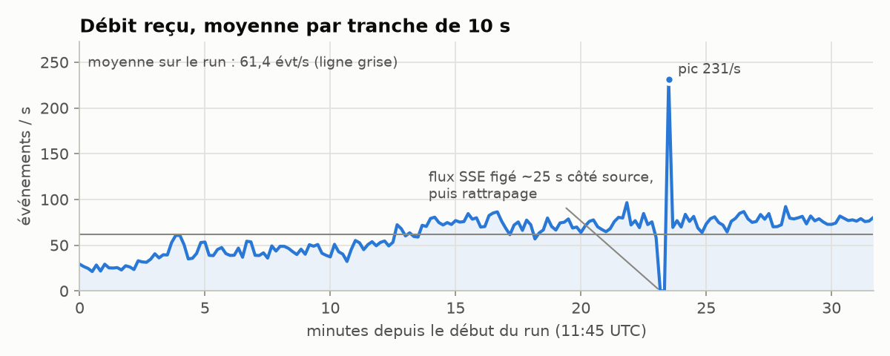
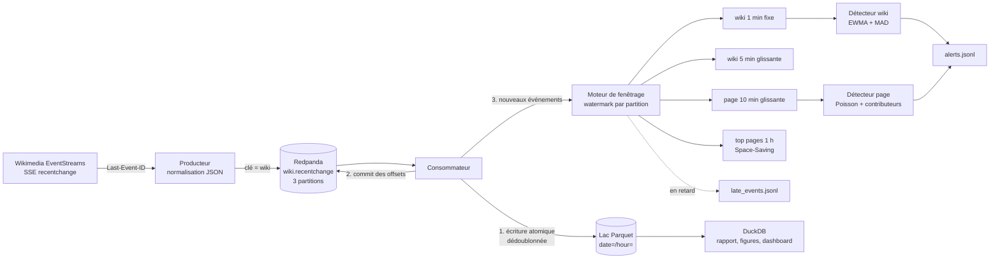
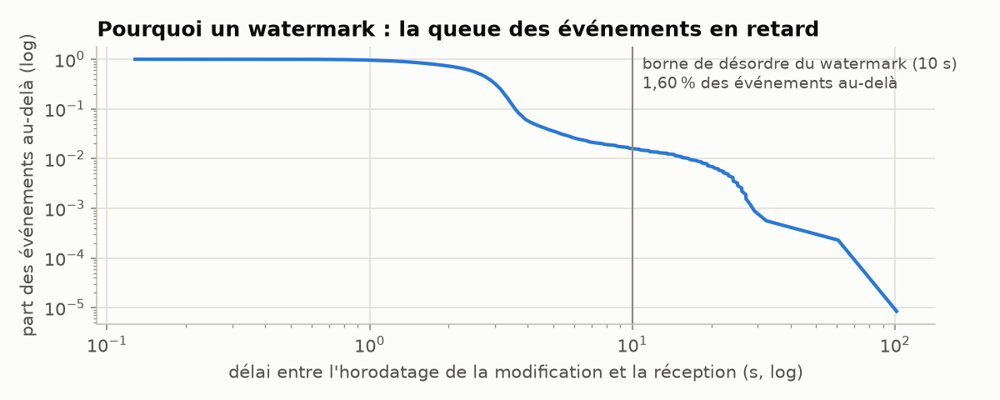
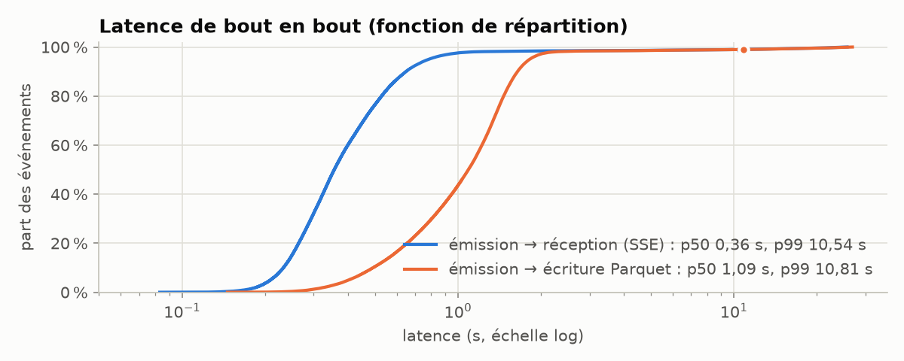
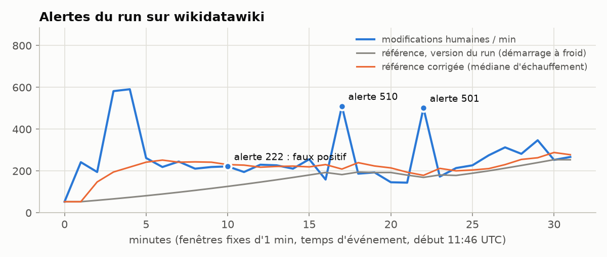

# wiki-stream

Pipeline de streaming temps réel branché sur toutes les modifications de Wikipédia et des autres wikis Wikimedia. Il lit le flux public `recentchange`, le fait passer par Redpanda (API Kafka), agrège en fenêtres de temps d'événement, repère les pics d'édition et écrit tout dans un lac Parquet interrogeable avec DuckDB. Le moteur de fenêtrage, les sketches et les détecteurs sont écrits à la main, sans Flink ni Spark : c'était le but de l'exercice.

Dépôt : https://github.com/pinpin-http/wiki-stream



## Ce que fait le projet

- Source : flux SSE `https://stream.wikimedia.org/v2/stream/recentchange`, une cinquantaine d'événements par seconde. Reconnexion automatique avec `Last-Event-ID`, User-Agent `wiki-stream/0.1 (https://github.com/pinpin-http/wiki-stream)` comme le demande la politique Wikimedia.
- Broker : Redpanda en `docker compose` (un cœur, 1 Go), topic `wiki.recentchange` à 3 partitions, clé = wiki, valeur = JSON compact. Sans Docker, un broker de repli sur fichiers journalisés prend le relais avec la même interface.
- Traitement : fenêtres fixes et glissantes en temps d'événement, watermark, événements en retard comptés à part, agrégats par wiki (modifications par minute, part de bots, octets ajoutés et retirés, nouvelles pages), top pages en mémoire bornée (Count-Min Sketch et Space-Saving).
- Détection : pics d'activité sur un wiki (EWMA + z-score robuste) et sur une page (score de Poisson sur fenêtres glissantes de 10 minutes), journalisés dans `data/out/alerts.jsonl`.
- Sink : Parquet partitionné par heure, écritures idempotentes, offsets commités après écriture. Requêtes DuckDB dans `sql/requetes.sql`.
- Rapport : `make report` produit les figures de `docs/` et un tableau de bord HTML statique (`docs/dashboard.html`), sans serveur.

## Architecture



Le producteur et le consommateur tournent dans le même processus Python (deux threads) pour rester léger ; ils peuvent aussi être lancés séparément (`wikistream produce`, `wikistream process`).

## Choix de conception

### Temps d'événement plutôt que temps de traitement

Chaque événement porte l'heure de la modification (`timestamp`) et l'heure d'émission côté Wikimedia (`meta.dt`). Les fenêtres utilisent la première. Avec le temps de traitement, une coupure réseau ou un rattrapage après redémarrage déplacerait les modifications dans la mauvaise minute et fabriquerait de faux pics, exactement ce que le détecteur doit éviter.

Le flux n'est pas ordonné. Sur le run mesuré, la moitié des événements arrive moins de 2,6 s après la modification, mais 1,6 % arrivent plus de 10 s après, et le plus lent 101 s après. Lors d'un premier essai, deux journaux d'import sur Commons sont même arrivés avec un horodatage de 2007. Ils ont fini dans la partition `date=2007-03-04` du lac, et hors de toute fenêtre.



### Watermark et retardataires

Le watermark suit le modèle « désordre borné » : W = max(horodatages vus) − 10 s. Il est calculé par partition Kafka, puis on prend le minimum sur les partitions actives, comme Flink. Une partition muette depuis 30 secondes de temps de traitement cesse de bloquer les autres. Le watermark ne recule jamais.

Une fenêtre [début, fin) est émise quand W ≥ fin. Un événement qui ne tombe plus dans aucune fenêtre ouverte est en retard : il n'est pas agrégé, il est compté (`late_events`) et écrit dans une sortie latérale. Pour les fenêtres glissantes, un événement trop tard pour certaines fenêtres mais pas pour toutes reste compté normalement, les rejets partiels sont suivis à part (`late_window_drops`). Le moteur gère aussi une tolérance de retard (`allowed_lateness`) : la fenêtre reste en mémoire après émission et un retardataire déclenche une ré-émission marquée `is_update`. Elle est testée mais réglée à 0 dans le run, pour que les détecteurs ne voient chaque minute qu'une fois.

Les 10 secondes sont un compromis lu sur les données : plus court, on perd plus d'événements ; plus long, chaque alerte arrive plus tard.

### Garanties de livraison

Côté broker, c'est du « au moins une fois » : le consommateur ne commite ses offsets qu'après avoir écrit le lot sur disque. Le lac reste sans doublon parce que l'écriture est idempotente :

1. chaque fichier Parquet est écrit dans un fichier temporaire, `fsync`, puis renommé (`os.replace` est atomique) ;
2. au démarrage, le sink relit la colonne `id` des 6 dernières partitions horaires ;
3. tout événement dont le `meta.id` (UUID Wikimedia) est déjà connu est écarté.

Le point 3 couvre aussi les rejeux côté source : après une reconnexion SSE avec `Last-Event-ID`, EventStreams peut renvoyer quelques événements déjà reçus. Le nom de fichier dérive du hachage des identifiants, donc réécrire le même lot écrase le même fichier.

Le test `test_sigkill_mid_run_no_loss_no_duplicate` tue le consommateur avec `SIGKILL` deux fois en plein travail, le relance, puis compare le lac à l'ensemble attendu : ni perte ni doublon. `test_crash_between_write_and_commit` vise le cas le plus délicat (fichiers renommés, offsets pas encore commités). Ce test a d'ailleurs trouvé un vrai bug : au redémarrage, le sink relisait les fichiers temporaires laissés à moitié écrits par le kill.

Le dédoublonnage porte sur l'identifiant et pas sur l'offset, car un offset ne désigne un événement que tant que le broker garde son journal. Pendant la deuxième coupure décrite plus bas, Redpanda a perdu la fin du sien : les offsets 13 024 à 13 044 de la partition 0, déjà présents dans le lac, ont été réattribués aux messages arrivés après le redémarrage. Un dédoublonnage par offset aurait écarté ces messages sans regarder ce qu'ils contenaient.

L'état du fenêtrage, lui, n'est pas checkpointé : après un crash, les fenêtres ouvertes à cet instant repartent incomplètes (voir Limites).

### Top pages en mémoire bornée

Sur une heure, plusieurs dizaines de milliers de pages distinctes sont modifiées. Le top est tenu par deux structures dont l'erreur est bornée et vérifiée par les tests sur des flux de Zipf :

- Space-Saving (k compteurs) : pour chaque page suivie, compte − erreur ≤ vraie fréquence ≤ compte, avec erreur ≤ N/k ; toute page de fréquence > N/k est forcément dans la liste. Garantie déterministe.
- Count-Min Sketch (largeur ⌈e/ε⌉, profondeur ⌈ln 1/δ⌉) : ne sous-estime jamais, et dépasse la vraie valeur de plus de εN avec une probabilité d'au plus δ.

Le rapport compare les deux au comptage exact fait par DuckDB sur le lac.

### Détection d'anomalies

Pour un wiki, la série est le nombre de modifications humaines par minute. Les 10 premières minutes servent d'échauffement : la référence part de la médiane de ces valeurs et l'échelle de leur MAD, parce que la première minute d'un run est presque toujours incomplète (ce point a été corrigé après le run, voir Résultats). Ensuite, la prévision suit une EWMA (α = 0,3) et l'écart est jugé par un z-score robuste : (x − EWMA) / max(1,4826 × MAD des 30 derniers résidus, √EWMA). La MAD résiste aux pics mieux qu'un écart-type, et le plancher de type Poisson évite les scores énormes sur une série très régulière. Les résidus sont écrêtés à ±3 échelles avant la mise à jour, pour qu'un pic ne gonfle pas la référence qui jugera le suivant.

Une alerte part si z ≥ 6, si la valeur dépasse 10 et 1,5 fois la référence, et si au moins 3 contributeurs humains ont participé à la minute ; en dessous, c'est en général une seule personne avec un outil semi-automatique. Quand trois comptes font plus de la moitié du pic, l'alerte est étiquetée « lot semi-automatique probable ». Le seuil de 6 vient d'une mesure : sur 60 000 minutes de bruit de Poisson simulé, z ≥ 5 donnait 4 fausses alertes, z ≥ 6 aucune.

Pour une page, un z-score sur l'historique n'aurait pas de sens : presque toutes ont un taux de base nul. Le détecteur compare le nombre de modifications humaines sur 10 minutes glissantes à une EWMA paresseuse (qui décroît pendant les fenêtres sans activité) avec un score de Poisson (x − λ)/√(λ + 1). Alerte si ≥ 5 modifications humaines sur un article, par ≥ 2 contributeurs distincts, et score ≥ 3,5. Une étiquette heuristique accompagne l'alerte : guerre d'édition probable (révocations dans les résumés), afflux de contributeurs, rafale d'un contributeur principal. Pendant les 10 premières minutes, les références sont apprises sans alerter.

Les deux détecteurs fonctionnent par épisode : une alerte à l'entrée, puis silence jusqu'à ce que la série redescende.

Les seuils de page ont été abaissés après un premier essai de 16 minutes : aucun article n'y avait dépassé 2 contributeurs humains en 10 minutes, et la première version (8 modifications, 3 contributeurs) ne pouvait rien voir.

## Résultats mesurés

Run continu du 4 novembre 2026, de 11:45:49 à 12:17:47 UTC (32 min), sur un portable 8 cœurs qui faisait autre chose en même temps. Redpanda était limité à un cœur et 1 Go, le processus Python à 60 % d'un cœur et 1,5 Go (portée systemd). Tous les chiffres sortent de `make report` (`docs/results.json`, `docs/dashboard.html`) et de `wikistream verify`.

| Mesure | Valeur |
|---|---|
| Événements écrits dans le lac | 117 846 (218 wikis), 0 doublon, 0 manquant par rapport au topic |
| Doublons écartés au sink | 2 (renvois après les reconnexions SSE de 12:00 et 12:15, Wikimedia coupe les flux toutes les 15 min) |
| Débit moyen | 61,4 évt/s (médiane par seconde : 61) |
| Pic de débit | 182 évt/s sur 1 s en régime normal ; 1 723 évt/s sur 1 s au rattrapage qui a suivi un gel du flux |
| Latence de bout en bout, émission Wikimedia → commit après écriture Parquet | p50 1,10 s, p90 1,66 s, p99 10,9 s, max 27,0 s |
| Même latence hors des 40 s du gel | p50 1,08 s, p99 2,04 s |
| Part du pipeline (réception → commit) | p50 0,69 s, p99 1,32 s, max 2,0 s |
| Événements en retard (hors fenêtre) | 61, soit 0,05 % ; retard médian 15 s, maximum 90 s |
| Alertes | 6, toutes au niveau wiki ; délai de détection après la fin de la fenêtre : 12,7 s en médiane |
| Lac | 1 436 fichiers Parquet, 22 Mo ; mémoire du processus : 163 Mo |

Le p99 à 10,9 s ne vient pas du pipeline. À 12:08:56 UTC, le flux SSE s'est figé environ 25 secondes sans se déconnecter, puis a livré 1 723 événements d'un coup. Ces 1 744 événements (1,5 % du total) tirent le p99 vers le haut ; sur la même minute, la part réception → écriture est restée à 1,75 s au p99. Le watermark a fait son travail : les fenêtres sont calculées en temps d'événement, et le rattrapage n'a créé aucun faux pic.

La médiane de 1,1 s se décompose en 0,36 s de transport SSE depuis Wikimedia et environ 0,7 s chez moi, pour l'essentiel l'attente du prochain lot d'écriture (une seconde au plus).



Pendant la mesure, la sonde thermique de la machine a abaissé à 25 % le plafond CPU des processus lourds, lors de 17 épisodes (55 des 384 relevés de 5 s). Les 16 365 événements écrits pendant ces épisodes ont pourtant la même latence que les autres : réception → écriture p99 1,27 s contre 1,30 s (`docs/throttle_latency.json`).

### Les alertes

Les 6 alertes du run portent sur Wikidata (3) et Commons (3). Les comptes de contributeurs ne sont pas nommés ici, et `docs/backtest_alerts.json` les remplace par des pseudonymes (« compte A », « compte B »…). Trois exemples :

- wikidatawiki, minute de 12:02 UTC : 510 modifications humaines contre une référence de 183 (z = 24). 54 comptes actifs, mais trois lots QuickStatements lancés en parallèle font l'essentiel : un compte crée des lexèmes (89 modifications, dont 44 créations), un deuxième corrige des éléments sur des sociétés d'anthropologie (90), un troisième ajoute la description hongroise « a Henry Draper katalógus csillaga » à des étoiles du catalogue HD (79).
- commonswiki, minute de 12:03 UTC : 136 modifications humaines contre 38 (z = 10,9). Un seul compte enchaîne 88 remplacements (« Doing 1 replacements. ») avec un outil de modification en masse.
- ruwiki, article « Граффити » (graffiti), vers 10:58 UTC, pendant le run interrompu par la première coupure : 6 modifications humaines en 10 minutes par 3 comptes, dont 3 révocations, étiquette « guerre d'édition probable ». Un compte temporaire ajoutait « роналдо » dans l'article ; un contributeur, puis le bot anti-vandalisme EyeBot (score ORES 0,847), ont annulé ses modifications, avant de les masquer.

Dans ce run de 32 minutes, aucune page n'a déclenché d'alerte. Il faut au moins 5 modifications humaines par 2 contributeurs en 10 minutes, à une heure où l'activité humaine sur un article donné est très faible.

Le bilan des alertes de wiki est mitigé, et la figure ci-dessous montre pourquoi. La première alerte du run (wikidatawiki, 222 contre 126 sur la minute de 11:55) était un faux positif : la référence partait de la première minute, incomplète, et l'écrêtage des résidus l'empêchait de remonter vite. Le détecteur a été corrigé après le run (échauffement par médiane et MAD), puis le même lac a été rejoué avec `wikistream backtest`. Le faux positif disparaît, les 5 autres alertes sont retrouvées sur les mêmes fenêtres, et 2 nouvelles apparaissent (zhwiki, un contributeur qui enregistre 23 fois en une minute ; Commons, encore un lot). Le rejeu étiquette 6 de ses 7 alertes « lot semi-automatique probable », car trois comptes y font plus de la moitié des modifications humaines : sur ce créneau, le détecteur trouve surtout des outils de modification en masse lancés depuis des comptes sans drapeau de bot. C'est une vraie anomalie de trafic, mais pas une actualité.



### Top pages

39 170 modifications sur 32 755 pages distinctes. Avec k = 2 000 compteurs, Space-Saving garantit une erreur d'au plus N/k = 19,6, et l'erreur maximale observée sur le top 20 est de 18. Le Count-Min (5 437 × 5, 212 Kio) a une borne εN de 19,6 et une erreur maximale observée de 6. Les bornes tiennent. En revanche, après les six premières pages, les comptes réels sont entre 18 et 28, plus serrés que l'erreur de Space-Saving : dans l'ordre de Space-Saving, 14 des 20 premières pages sont réellement dans le top 20 (ex æquo compris). Une fois ses candidats reclassés par l'estimation du Count-Min, on passe à 20/20. Le rapport combine donc les deux : Space-Saving fournit la liste, le Count-Min fixe l'ordre.

## Deux vraies coupures

La machine s'est éteinte d'un coup deux fois pendant la journée de mesure : protection thermique la première fois, la seconde après des tests GPU d'un autre programme. Ni le processus Python ni Redpanda n'ont pu s'arrêter. Ces deux runs interrompus ne servent pas aux chiffres de débit et de latence, mais ils ont testé la reprise mieux qu'un `kill -9`. Le détail est dans [`docs/crash_recovery.json`](docs/crash_recovery.json). Les contrôles viennent de `wikistream verify`, qui relit le topic entier et chaque fichier du lac.

Première coupure (11:10 UTC, après 28 min de capture) :

- les 1 249 fichiers Parquet étaient lisibles en entier, sans fichier temporaire : 70 965 lignes, aucun doublon ;
- les offsets commités dans Redpanda valaient exactement le dernier offset écrit + 1 sur chaque partition. Le dernier lot avait été écrit puis commité, il restait 21 messages à lire ;
- le consommateur relancé a lu et écrit ces 21 messages ;
- le producteur relancé a repris au `Last-Event-ID` sauvegardé quelques secondes avant la coupure. EventStreams a renvoyé les 7 minutes manquantes en une dizaine de secondes (pic à 4 330 évt/s), dont 272 événements déjà écrits, que le sink a écartés ;
- bilan : 85 319 messages dans le topic, 85 047 identifiants distincts, et exactement les mêmes 85 047 dans le lac.

Deuxième coupure (11:37 UTC, après 17 min) : plus intéressante, parce que le broker a perdu des données. En `--mode dev-container`, Redpanda tourne avec `--unsafe-bypass-fsync=true`. Au redémarrage, la fin de son journal avait disparu : 40 messages pourtant acquittés (`acks=all`), et des commits d'offsets remontant 26 messages en arrière. Le lac, écrit avec `fsync`, contenait ces 40 événements. Le consommateur a relu les 26 messages, le producteur a repris le flux SSE et renvoyé 87 événements déjà connus, dont les 40 perdus par le broker. Le sink a écarté les 113 doublons. Bilan : 40 610 identifiants distincts dans le topic comme dans le lac, ni doublon, ni manque, ni surplus.

## Limites

- L'état du fenêtrage n'est pas checkpointé. Après un crash, le lac reste exact, mais les fenêtres ouvertes à cet instant repartent incomplètes et les détecteurs perdent leur historique. La suite logique serait de sauvegarder les accumulateurs avec les offsets, à la manière des checkpoints de Flink.
- Le dédoublonnage couvre les 6 dernières partitions horaires. Un doublon qui arriverait plus tard passerait. En pratique, les rejeux viennent du dernier lot non commité ou d'une reprise SSE, donc de quelques secondes.
- Petits fichiers : un fichier Parquet par lot (une seconde) et par heure. Il n'y a pas de compaction. DuckDB s'en accommode à cette échelle, pas à celle d'un vrai lac.
- L'index des identifiants vit dans la mémoire d'un seul consommateur. Avec plusieurs consommateurs dans le groupe, il faudrait un index partagé ou un sink transactionnel.
- La latence compare l'horloge des serveurs Wikimedia (`meta.dt`) à la mienne, synchronisée par NTP. Quelques dizaines de millisecondes d'écart sont possibles. La médiane est surtout due à l'intervalle d'écriture d'une seconde choisi pour le sink, un compromis entre latence et nombre de fichiers.
- Pas de modèle saisonnier : sur une heure, le cycle jour/nuit est invisible. Sur plusieurs jours, il faudrait une référence par heure de la semaine.
- La détection des révocations lit les résumés de modification (expressions régulières en une quinzaine de langues). Elle rate les résumés personnalisés, et les étiquettes des alertes restent des indices à vérifier.
- Le run a eu lieu un mercredi midi, heure européenne, et le plus long run continu a duré 32 minutes. Je n'ai observé ni la mémoire sur plusieurs heures (l'état du détecteur de pages grandit avec le nombre de pages vues), ni le trafic d'un soir d'élection.
- Redpanda tourne en `--mode dev-container`, donc sans `fsync` et sans réplication. La deuxième coupure l'a montré : un broker de production (mode production, facteur de réplication 3) ne perdrait pas ces 40 messages. Ici, c'est la reprise SSE qui les a rattrapés, et seulement parce que la position sauvegardée était plus ancienne que les messages perdus.
- Le broker fichier n'a ni réplication ni rétention et n'accepte qu'un producteur. Il sert au développement et aux tests.

## Lancer le projet

Prérequis : `uv`, Docker avec Compose (facultatif), `make`.

```sh
make install          # venv Python 3.12 + dépendances épinglées
make up               # Redpanda + création du topic
make run              # 45 min par défaut ; DURATION=600 make run pour 10 min
make report           # figures PNG + docs/dashboard.html + docs/results.json
make test             # tests, sans réseau
make verify           # relit le topic et le lac : ni perte ni doublon ?
make down             # arrête et supprime le conteneur et son volume
```

Sans Docker : `make run-offline` utilise le broker fichier (`data/broker/`). Pour rejouer la fixture sans réseau :

```sh
.venv/bin/python -m wikistream --broker file replay tests/fixtures/recentchange_sample.jsonl
.venv/bin/python -m wikistream --broker file process --idle-exit 2
.venv/bin/python -m wikistream --broker file sql --file sql/requetes.sql
```

Les données vont dans `data/` (ignoré par git) : `data/lake/` pour le Parquet, `data/out/` pour les fenêtres, alertes, retardataires, métriques et le résumé du run.

## Organisation du code

| Module | Rôle |
|---|---|
| `source.py` | client SSE, parseur conforme à la spec, reprise `Last-Event-ID` |
| `events.py` | normalisation des événements, détection des révocations |
| `broker/` | interface commune, Kafka (librdkafka) et journal de fichiers |
| `producer.py` | SSE → topic, métriques de débit |
| `windowing.py` | fenêtres, watermark, retards, tolérance de retard |
| `aggregates.py` | agrégats par wiki, par page, top pages |
| `sketch.py` | Count-Min Sketch, Space-Saving, heavy hitters |
| `anomalies.py` | détecteurs wiki et page |
| `sink.py` | Parquet partitionné, écriture atomique, dédoublonnage |
| `processor.py` | boucle du consommateur, ordre écriture → commit → analyse |
| `dashboard.py` | requêtes DuckDB, figures, page HTML |
| `cli.py` | commandes `run`, `produce`, `process`, `verify`, `backtest`, `report`, `sql`, `replay` |

## Données et licence

Le code est sous licence MIT. Les événements viennent de Wikimedia EventStreams : les métadonnées sont publiées sous CC0, les éléments textuels qu'elles reprennent (titres, résumés de modification, noms d'utilisateurs) relèvent des wikis d'origine, sous CC BY-SA 4.0. La fixture `tests/fixtures/recentchange_sample.jsonl` (220 événements, 214 Ko) suit les mêmes conditions.
